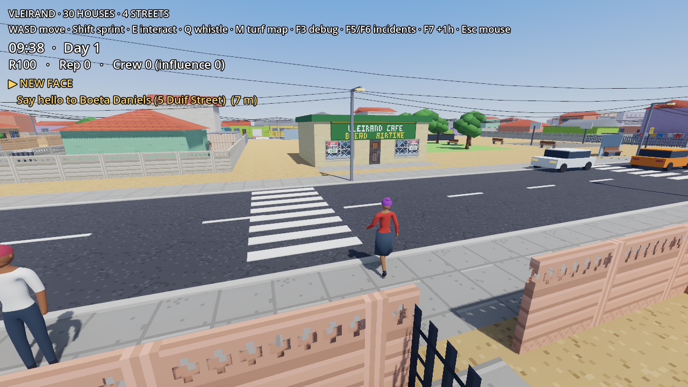
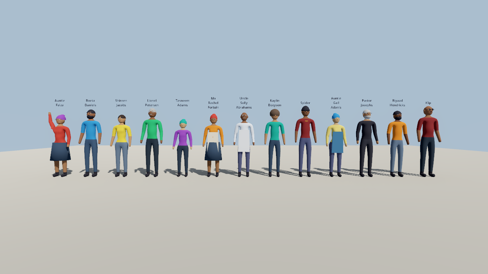
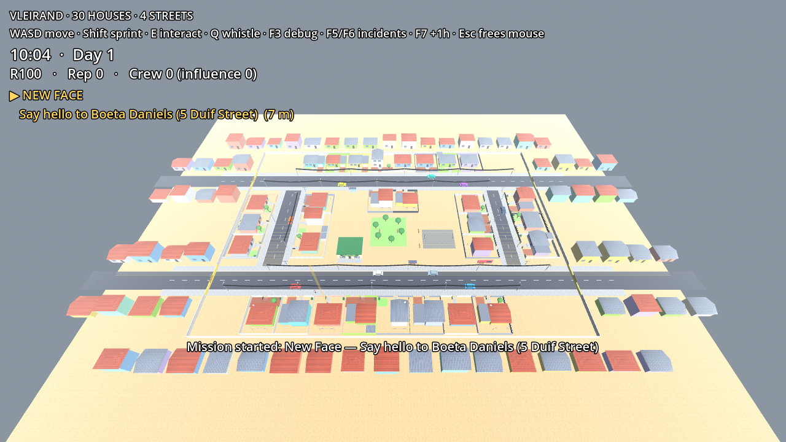
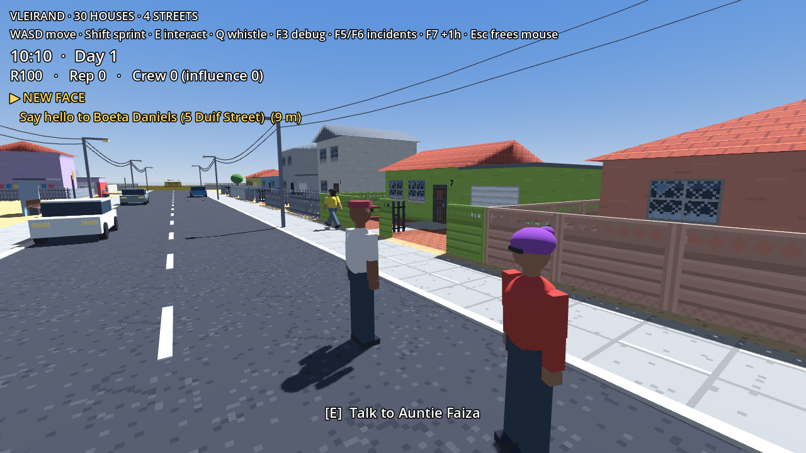
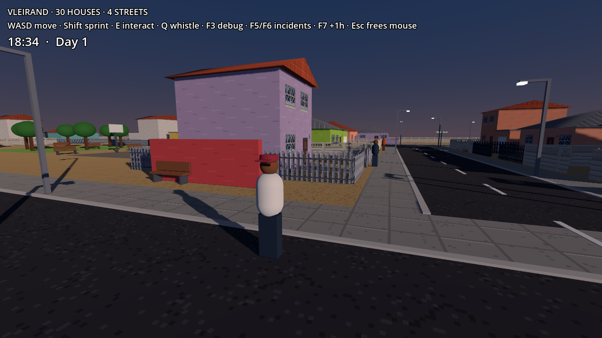
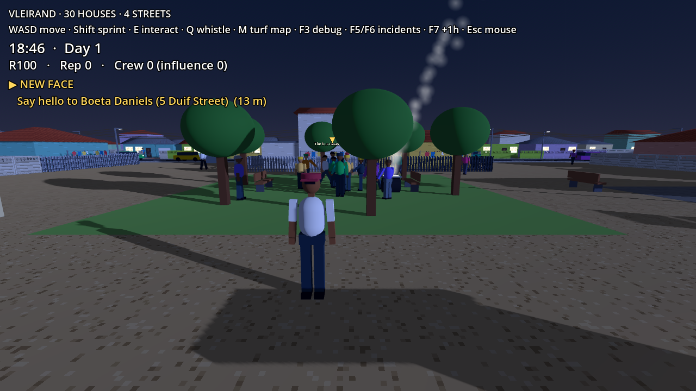
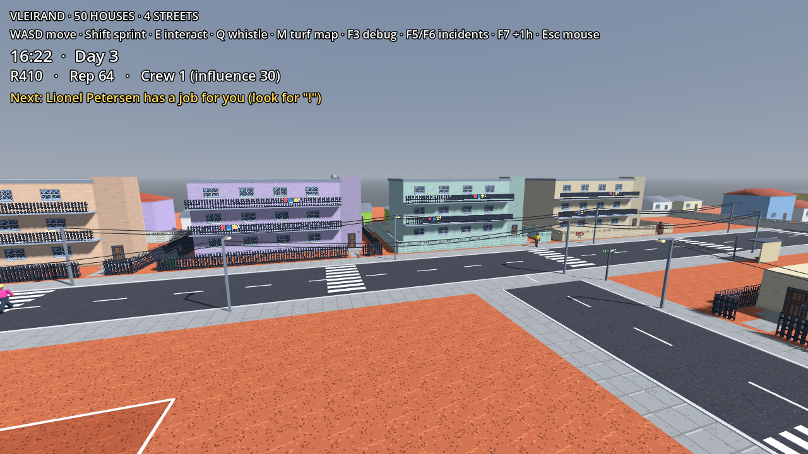
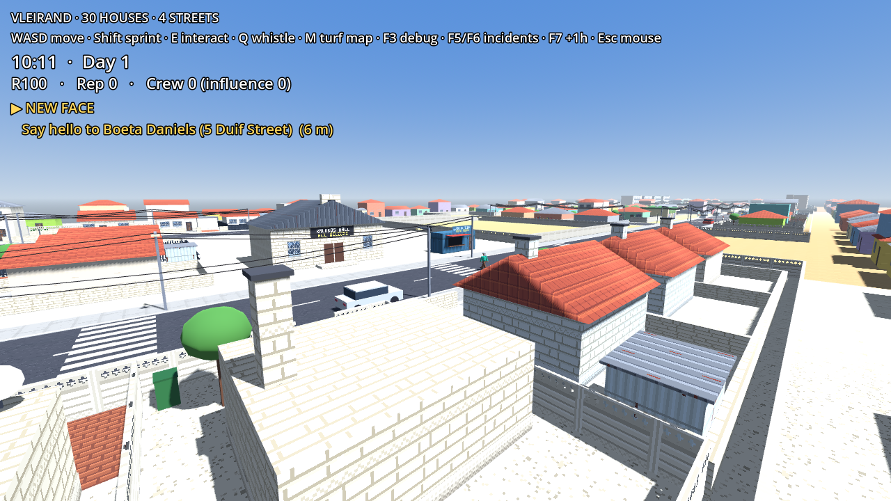
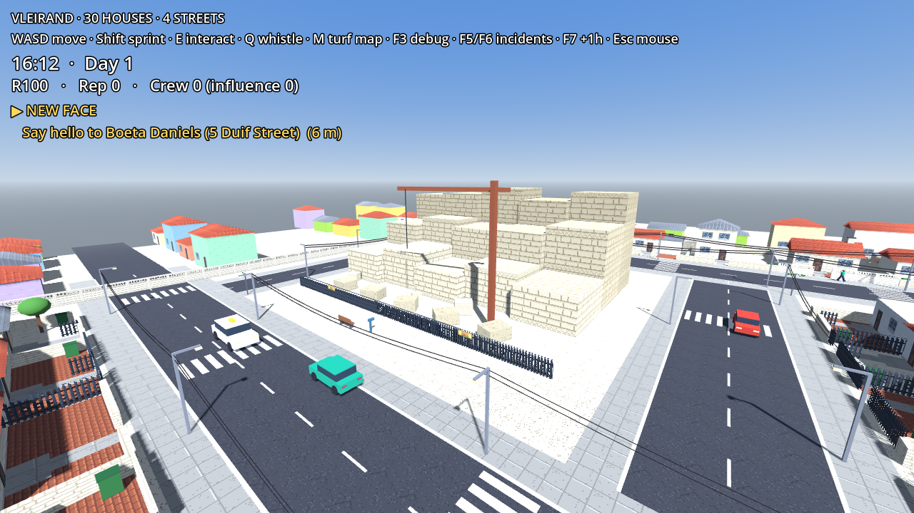

# Gangstars — Claude Code Development Kit

> **Current state:** playable. Set in Mitchells Plain on the Cape Flats: the starter suburb, Westridge, has 30 houses
> on 4 streets, 28 residents with day/night routines, social groups, reactions to incidents, and a
> rival crew that patrols at night. Five intro missions, a recruitable crew member, safehouse
> upgrades, save/load, and a turf map with locked neighbouring districts (Lentegeur, Rocklands) that
> open through progression. Left-hand traffic and drivable cars, weather, braais and
> load-shedding, synthesized audio, and a settings menu. Lentegeur, the first expansion district
> (flats, container shops, a soccer field and the Dune Cruisers), and Rocklands to the west (limestone
> cottages, an old quarry and the Rock Royals) are built from the same data pipeline.
> Walk into your safehouse, the smokkies and neighbours' homes (knock first). Fight over street
> corners, follow a story with choices, and drive with the radio on.
> Start the hustle at Aunty Mavis' smokkie: serve drinks, save clients on your phone, and make
> street deals without SAPS seeing (clients who wait too long go to rival crews).
> Runs on Windows/Linux/macOS desktops with keyboard + mouse or a gamepad. Windows build:
> `tools/export_windows.sh` → `build/windows/Gangstars.exe`. From source: `godot --path .` (Godot 4.5.1). Tests: `godot --headless --path . --fixed-fps 60 -s tests/run_tests.gd`.
> See `docs/TECH_NOTES.md`, `docs/ROADMAP.md`, and `docs/screenshots/`.
>
> 
> 
> 
> 
> 
> 
> 
> 
> 

A production-minded starter kit for building a **3D open-neighbourhood gangster / street-crime game** in **Godot 4.x + GDScript** with Claude Code.

This is a development brief and agent/skill pack, not a finished playable game. It gives Claude Code the game vision, architecture, implementation order, constraints, specialist roles, reusable skills, and testable acceptance criteria.

## Core game concept

The first playable district is a compact community of approximately **30 houses**, connected by streets, pavements, yards, alleys, and a few community locations. The neighbourhood should feel alive:

- Pedestrian NPCs physically walk between homes, shops, corners, and street destinations.
- Residents leave houses, travel along sidewalks/roads, enter buildings, and return later.
- Gang members patrol, gather, react to events, and move between their safehouse and street locations.
- Vehicles can drive through the street network when the driving milestone is reached.
- The player can explore, interact, build reputation, recruit allies, complete missions, and contest territory.
- The initial district is the only playable territory at launch. **Additional turf is locked and unlocks later** through progression.

## Recommended stack

- **Engine:** Godot 4.x (use the stable release installed on the developer's machine).
- **Language:** GDScript, typed where practical.
- **3D:** CharacterBody3D, NavigationAgent3D, NavigationRegion3D, GridMap or modular meshes.
- **Input:** Godot Input Map; keyboard/mouse first, controller-ready.
- **Data:** Resources and JSON only where appropriate; keep gameplay data separate from presentation.
- **Version control:** Git. Commit in small, working increments.

Godot is recommended because it is free, open source, lightweight, and Claude can work directly with its text-based scenes/scripts. Do not silently switch engines. If the repository already contains a different engine project, inspect it and ask before migrating.

## Start here

1. Add the **contents of this ZIP** to the root of your Git repository. Keep hidden folders such as `.claude/`.
2. Open the repository in Claude Code.
3. Give Claude this first instruction:

   > Read `CLAUDE.md`, then read `docs/ROADMAP.md`, `docs/GAME_DESIGN.md`, and `docs/ARCHITECTURE.md`. Inspect the repository and Godot version before changing anything. Do not attempt the whole game at once. Propose the first vertical slice, then implement only Phase 0 and Phase 1 with runnable scenes and tests. Keep the roadmap updated as work is completed.

4. Ask Claude to run the project with the installed Godot executable and report any errors. Do not accept code that has not been run.

## Package contents

- `CLAUDE.md` — master instructions Claude must follow.
- `.claude/agents/` — specialist agents for gameplay, world/NPC simulation, systems, QA, and art direction.
- `.claude/skills/` — reusable workflows Claude should load for planning, Godot implementation, NPC simulation, world building, and testing.
- `docs/` — game design, roadmap, architecture, NPC behaviour, world layout, mission progression, and definition of done.
- `project/` — initial project conventions and input/action naming guidance.

## Important scope rule

The game must become playable early. Build a small, complete vertical slice first, then expand it to the full 30-house neighbourhood. Do not create 30 detailed interiors before the player can move, interact, and see NPCs moving around the block.
